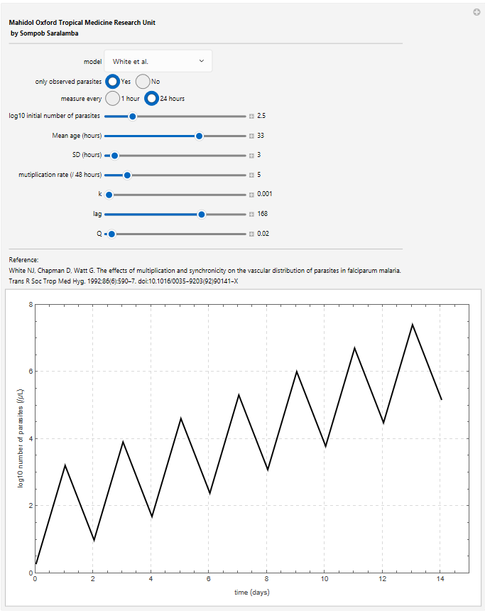
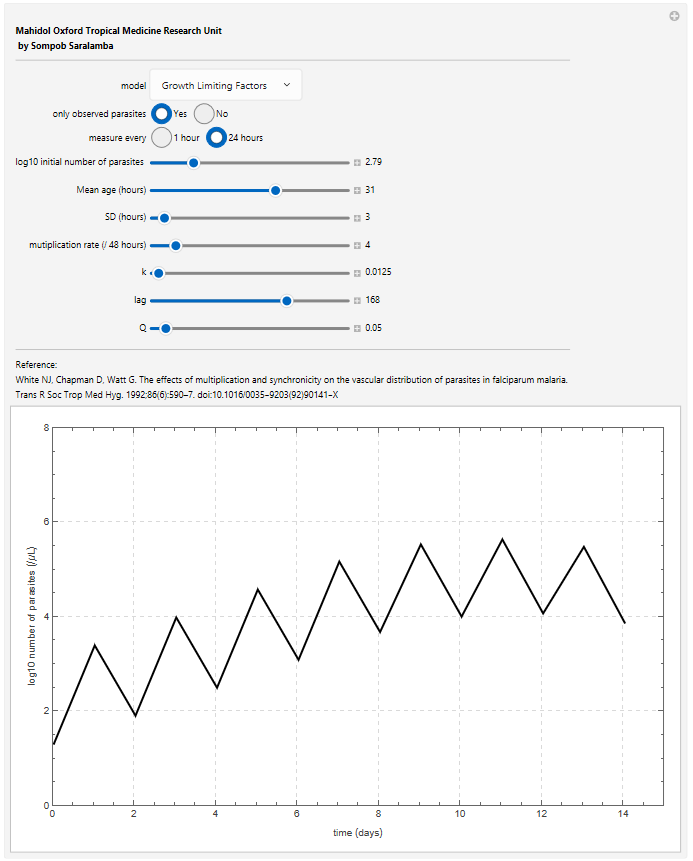

# ExpansionPhase

**Code accompanying the published research article:**

**The dynamics of *Plasmodium falciparum* during the expansion phase of the asexual stage of infection**

Sompob Saralamba, Bo Gao, Naowarat Saralamba, Ricardo Aguas and Wirichada Pan-ngum.

*Malaria Journal* (2026). Published 25 September 2026.

**Publication:** https://doi.org/10.1186/s12936-026-06150-1

---

## Overview

This repository contains the mathematical models, Bayesian inference code, and figures accompanying our research article published in *Malaria Journal*.

The study extends the age-structured within-host model of White et al. by incorporating growth-limiting mechanisms acting on merozoites and asexual blood-stage parasites.

The models were fitted using a Bayesian framework implemented in Stan, primarily using historical *Plasmodium falciparum* malariotherapy data. The published study also examined parasite trajectories from controlled human malaria infection (CHMI) studies.

Interactive Wolfram Mathematica notebooks are provided to allow users to explore the effects of model parameters on within-host parasite dynamics.

The extended model was developed to reproduce three characteristic patterns observed during the expansion phase of infection:

- Sustained exponential parasite growth
- Parasite growth followed by a plateau
- Parasite growth followed by a decline

## Repository structure

```text
ExpansionPhase/
├── Figures/
├── Stan/
├── Wolfram/
└── README.md
```

### 📁 Wolfram

This folder contains interactive Wolfram Mathematica notebooks for two models:

- **Original model** – The age-structured within-host model of White et al.
- **Extended model** – The model incorporating growth-limiting mechanisms.

The notebooks use Mathematica's `Manipulate` function, allowing users to adjust model parameters using interactive sliders and immediately visualise changes in predicted parasite dynamics.





### 📁 Stan

This folder contains the Stan code used for Bayesian parameter estimation.

**File naming convention:**

- **NJW*** – Original age-structured model.
- **NJWQ*** – Extended model incorporating growth-limiting mechanisms.

These models were used for individual-level and hierarchical population-level inference described in the published article.

### 📁 Figures

This folder contains figures presented in the published article, including:

- Observed parasite trajectories
- Representative model fits
- Parameter distributions
- Population-level model predictions
- Other publication figures

---

## Software requirements

### Wolfram Mathematica

To explore the interactive models:

- Wolfram Mathematica (Version 12 or later recommended)

### Stan

To reproduce the Bayesian model fitting, a compatible Stan interface is required, such as:

- CmdStan
- CmdStanR
- RStan

The Stan model files may require appropriate input data and sampling configurations to reproduce the published analyses.

---

## Models

Two within-host models are included.

### Original model

The original age-structured model of White et al. describes the within-host dynamics of asexual *Plasmodium falciparum* parasites, incorporating parasite development, multiplication, and sequestration over the 48-hour erythrocytic cycle.

### Extended model

The extended model incorporates additional growth-limiting mechanisms through:

- A delayed reduction in effective parasite multiplication
- Continuous removal of asexual blood-stage parasites

These mechanisms allow the model to reproduce parasite trajectories exhibiting sustained growth, plateauing, or declining parasite densities during the expansion phase of infection.

The full model formulations, assumptions, and estimation methods are described in the published article.

---

## Publication and citation

If you use the models or code provided in this repository, please cite the following publication:

Saralamba S, Gao B, Saralamba N, Aguas R, Pan-ngum W. **The dynamics of *Plasmodium falciparum* during the expansion phase of the asexual stage of infection.** *Malaria Journal*. 2026.

**DOI:** https://doi.org/10.1186/s12936-026-06150-1

### BibTeX

```bibtex
@article{Saralamba2026ExpansionPhase,
  author = {Saralamba, Sompob and Gao, Bo
            and Saralamba, Naowarat
            and Aguas, Ricardo
            and Pan-ngum, Wirichada},
  title = {The dynamics of Plasmodium falciparum
           during the expansion phase of the
           asexual stage of infection},
  journal = {Malaria Journal},
  year = {2026},
  doi = {10.1186/s12936-026-06150-1},
  url = {https://doi.org/10.1186/s12936-026-06150-1}
}
```

---

## Contact

For questions regarding the code or mathematical models, please contact:
**Email:** sompob@tropmedres.ac

---

## License

This repository is released under the MIT License.

The published article is available under the Creative Commons Attribution 4.0 International License (CC BY 4.0). The article's licence is separate from the licence governing this repository's code.
